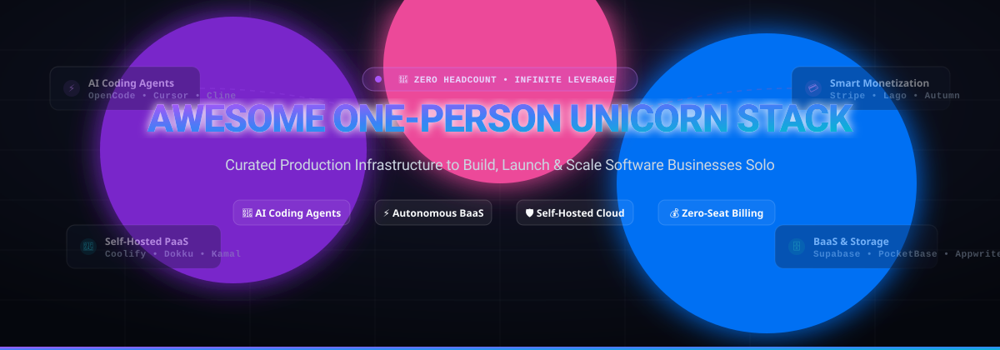

<div align="center">



# 🦄 Awesome One-Person Unicorn Stack

**The Definitive Ecosystem for Solo Founders, Indie Hackers, and Zero-Headcount AI Software Companies**

<p align="center">
  <a href="https://github.com/ishandutta200//Awesome-Awesome-Awesome"></a><a href="https://discord.gg/jc4xtF58Ve"></a>
  <a href="https://github.com/ishandutta2007/Awesome-One-Person-Unicorn-Stack/stargazers"></a>
  <a href="https://github.com/ishandutta2007/Awesome-One-Person-Unicorn-Stack/network/members"></a>
  <a href="https://github.com/ishandutta2007/Awesome-One-Person-Unicorn-Stack/blob/main/LICENSE"></a>
  <a href="https://github.com/ishandutta2007/Awesome-One-Person-Unicorn-Stack/issues"></a>
  <a href="https://github.com/ishandutta2007"></a>
</p>

*Curated list of production-grade SaaS platforms and battle-tested open-source repositories powering billion-dollar software operations run by a single individual.*

---

</div>

## 📑 Table of Contents

- [🌟 Why the One-Person Unicorn Stack?](#-why-the-one-person-unicorn-stack)
- [📊 Sector Overview & Market Dynamics](#-sector-overview--market-dynamics)
- [🏢 SaaS Platforms (Hosted & Managed)](#-saas-platforms-hosted--managed)
- [🛠️ Open-Source GitHub Projects (Self-Hosted Alternatives)](#️-open-source-github-projects-self-hosted-alternatives)
- [🧱 Architectural Blueprint for Solo Founders](#-architectural-blueprint-for-solo-founders)
- [🤝 How to Contribute](#-how-to-contribute)
- [💖 Support & Sponsorship](#-support--sponsorship)
- [📈 Star History](#--star-history)
- [⚖️ Disclaimer & Security Notice](#️-disclaimer--security-notice)

---

## 🌟 Why the One-Person Unicorn Stack?

The historical constraint of building a technology company was **headcount leverage**: engineering teams, QA analysts, DevOps engineers, database administrators, and billing specialists. 

The convergence of **autonomous AI coding agents**, **Backend-as-a-Service (BaaS)**, **serverless deployment runtimes**, and **drop-in transactional billing** has permanently collapsed development cycles from *team-years* to *solo-weeks*. Today, a single developer operating with the right modular stack can launch, scale, and maintain an enterprise-grade software business with **zero employees** and near-zero upfront capital expenditure.

---

## 📊 Sector Overview & Market Dynamics

> 💡 **Estimated Market Size**: The global market for AI-assisted software development, developer productivity platforms, and solopreneur infrastructure is projected to expand from **$12.8 Billion in 2024 to over $45.6 Billion by 2030**, advancing at a compound annual growth rate (**CAGR of ~23.5%**).

> ⚖️ **Market Concentration & Dynamics**: The sector displays a **bimodal market structure**:
> - **Consolidated & Winner-Take-Most (Infrastructure Layer)**: Foundational layers like global payments processing (Stripe) and hosted cloud runtimes/databases (Microsoft/GitHub, Vercel, Supabase) exhibit strong developer network effects, high switching moats, and winner-take-most dominance.
> - **Highly Fragmented & Disruptive (AI Agent & Tooling Layer)**: Autonomous AI coding companions, prompt-to-app builders (Cursor, Lovable, Bolt.new, v0), and self-hosted open-source orchestrators (OpenCode, Cline, Aider, Coolify) operate in rapid technological flux with aggressive open-source substitution, low barriers to developer experimentation, and fierce competition.

---

## 🏢 SaaS Platforms (Hosted & Managed)

The premier hosted platforms that eliminate operational overhead for solo operators. Ranked in **descending order by company valuation / revenue scale**.

| 🚀 Platform | 🏷️ Solo Role & Layer | 💰 Valuation / Scale | 🏷️ Starting Pricing | 🎁 Free Tier Limits | ⚡ Key Capabilities |
| :--- | :--- | :--- | :--- | :--- | :--- |
| **[GitHub Copilot](https://github.com/features/copilot)** | AI Pair Programmer & Agent | **$3.1T Market Cap** *(Microsoft parent)* / **$1B+ ARR** *(GitHub)* | **$10/month** *(Copilot Individual; or $100/year)* | **30-Day Free Trial** *(Full access)*; **Free forever** for verified students, teachers, & maintainers of popular OSS | Codebase-wide completions, agentic multi-file refactoring, terminal CLI assistance, and PR generation across VS Code & JetBrains. |
| **[Stripe](https://stripe.com/)** | Global Payments & Billing Engine | **$70 Billion Valuation** / **$14B+ Net Revenue** | **2.9% + $0.30** per successful card charge | **Free Forever Test Sandbox** *(No subscription fee; unlimited mock API transactions & test cards)* | Global hosted checkout, customer billing portal, automated sales tax (Stripe Tax), fraud detection (Radar), and invoicing. |
| **[v0 by Vercel](https://v0.app/)** | Generative UI & Design Engine | **$3.25 Billion Valuation** / **$250M+ ARR** *(Vercel)* | **$20/month** *(Premium plan: 5,000 credits/mo)* | **Free Forever: 200 credits/month** *(Renewed monthly; unlimited public chat & live Next.js sandbox preview)* | Generates production-ready React components trained on Tailwind CSS, React 19, and shadcn/ui; instant one-click Vercel deployment. |
| **[Cursor](https://cursor.com/)** | AI-Native IDE & Codebase Agent | **$2.5 Billion Valuation** / **$100M+ ARR** | **$20/month** *(Pro plan: 500 fast requests/mo + unlimited slow requests)* | **Free Forever: 50 slow requests/mo + 200 Cursor Tab completions/mo** *(Includes 14-day Pro trial with 500 fast requests)* | Full VS Code fork featuring intelligent codebase semantic search, multi-file agentic editing (Composer), and automated terminal debugging. |
| **[Replit Agent](https://replit.com/)** | Autonomous Full-Stack Builder | **$1.4 Billion Valuation** / **$25M+ ARR** | **$15/month** *(Billed annually at $120/yr, or $20/mo monthly for Replit Core)* | **Free Forever Starter: 3 public deployments, 0.5 vCPU, 512 MB RAM, 10 GB storage** *(Full agent requires Replit Core)* | Natural language autonomous software development: scuffs schemas, installs packages, tests server runtimes, and provisions cloud hosting. |
| **[Supabase](https://supabase.com/)** | Hosted Backend-as-a-Service | **$500 Million Valuation** / **$30M+ ARR** | **$25/month/project** *(Pro plan: 8 GB disk, 250 GB egress, daily backups)* | **Free Forever: 2 active projects, 500 MB Postgres database, 1 GB file storage, 50,000 MAU, 500K Edge invocations** | Managed PostgreSQL with real-time replication, built-in Auth (OAuth, magic links), Storage buckets, Vector embeddings, and auto-generated APIs. |
| **[Linear](https://linear.app/)** | Project Management & Roadmap | **$400 Million Valuation** / **$20M+ ARR** | **$8/user/month** *(Billed annually, or $10/user/mo monthly for Standard plan)* | **Free Forever: Unlimited users, up to 250 active issues**, 10 MB file upload limit, unlimited API integrations | Lightning-fast keyboard-first issue tracking, sprint cycles, customer roadmap tracking, and native GitHub bi-directional sync. |
| **[Bolt.new](https://bolt.new/)** | In-Browser WebContainer IDE | **$300 Million Valuation** *(StackBlitz parent)* / **$15M+ ARR** | **$20/month** *(Pro plan: 10 Million prompt tokens/month, private projects)* | **Free Forever: 200,000 tokens/day**, unlimited public sandboxes, full client-side Node.js environment | Full-stack development environment inside Chrome powered by WebContainers; boots Node.js backends, installs npm modules, and live previews apps. |
| **[Lovable](https://lovable.dev/)** | Prompt-to-App & Cloud Platform | **$50+ Million Valuation** / **$10M+ ARR** | **$20/month** *(Pro plan: 100 message credits/mo, custom domains, private repos)* | **Free Forever: 5 messages/day** *(Public projects only, Lovable Cloud sandbox testing)* | Generates end-to-end fullstack React applications connected directly to built-in Lovable Cloud (managed PostgreSQL, Auth, and Storage). |
| **[Resend](https://resend.com/)** | Developer Transactional Email API | **$50 Million Valuation** / **$5M+ ARR** | **$20/month** *(Pro plan: 50,000 emails/month, 10 domains, dedicated IP options)* | **Free Forever: 3,000 emails/month** *(100 emails/day ceiling, 1 verified domain)* | Modern email infrastructure designed for developers with first-class React Email component templates and deliverability analytics. |

---

## 🛠️ Open-Source GitHub Projects (Self-Hosted Alternatives)

For solo founders who demand **zero per-seat SaaS costs**, **complete data privacy**, and **zero vendor lock-in**, these battle-tested open-source repositories replace hosted tiers on your own VPS. 

Ranked in **descending order by GitHub Stargazer Count**:

1. **[OpenCode](https://github.com/anomalyco/opencode)** [](https://github.com/anomalyco/opencode/stargazers) — Terminal-native autonomous AI coding agent with multi-model support, fast local AST indexing, and scriptable automated code refactoring.
2. **[n8n](https://github.com/n8n-io/n8n)** [](https://github.com/n8n-io/n8n/stargazers) — Fair-code workflow automation platform with native AI agent orchestration, 400+ API connectors, and webhook routing for zero-maintenance operations.
3. **[Ollama](https://github.com/ollama/ollama)** [](https://github.com/ollama/ollama/stargazers) — Run state-of-the-art open-weight LLMs (Llama 3, DeepSeek, Mistral) locally on Mac/Linux/Windows with zero API costs and an OpenAI-compatible endpoint.
4. **[Supabase](https://github.com/supabase/supabase)** [](https://github.com/supabase/supabase/stargazers) — The open-source Firebase alternative: self-hostable PostgreSQL, Auth, real-time websockets, storage buckets, and auto-generated REST/GraphQL APIs.
5. **[vLLM](https://github.com/vllm-project/vllm)** [](https://github.com/vllm-project/vllm/stargazers) — High-throughput and memory-efficient inference serving engine utilizing PagedAttention for founders hosting their own GPU model backends.
6. **[OpenHands](https://github.com/OpenHands/OpenHands)** [](https://github.com/OpenHands/OpenHands/stargazers) — Autonomous AI software development agent platform executing shell commands, browsing documentation, writing tests, and opening pull requests.
7. **[Apache Superset](https://github.com/apache/superset)** [](https://github.com/apache/superset/stargazers) — Enterprise-grade open-source business intelligence, interactive data visualization, and real-time operational dashboarding platform.
8. **[Cline](https://github.com/cline/cline)** [](https://github.com/cline/cline/stargazers) — Autonomous AI coding agent extension for VS Code with terminal execution, file diffing, browser automation, and Model Context Protocol (MCP) tool support.
9. **[Coolify](https://github.com/coollabsio/coolify)** [](https://github.com/coollabsio/coolify/stargazers) — Self-hostable, all-in-one PaaS alternative to Vercel, Heroku, and Netlify; deploy full-stack applications, databases, and microservices on any VPS.
10. **[PocketBase](https://github.com/pocketbase/pocketbase)** [](https://github.com/pocketbase/pocketbase/stargazers) — Open-source realtime backend in a single Go binary with embedded SQLite, auth management, file storage, and an elegant admin dashboard.
11. **[Plane](https://github.com/makeplane/plane)** [](https://github.com/makeplane/plane/stargazers) — Modern open-source project management and issue tracker; a clean, self-hosted alternative to Jira and Linear with cycles, modules, and roadmaps.
12. **[Twenty](https://github.com/twentyhq/twenty)** [](https://github.com/twentyhq/twenty/stargazers) — Modern open-source CRM alternative to Salesforce and HubSpot, built for high developer flexibility and autonomous AI sales pipelines.
13. **[Appwrite](https://github.com/appwrite/appwrite)** [](https://github.com/appwrite/appwrite/stargazers) — End-to-end self-hosted backend platform for web and mobile developers providing Auth, Databases, Storage, and Serverless Edge Functions.
14. **[Ghost](https://github.com/TryGhost/Ghost)** [](https://github.com/TryGhost/Ghost/stargazers) — Open-source publishing platform with native memberships, newsletters, and Stripe subscription monetization for building audience-driven businesses.
15. **[Metabase](https://github.com/metabase/metabase)** [](https://github.com/metabase/metabase/stargazers) — Easy-to-use open-source business intelligence and KPI dashboards that connect to any database in minutes without SQL mastery.
16. **[Aider](https://github.com/Aider-AI/aider)** [](https://github.com/Aider-AI/aider/stargazers) — Command-line AI pair programmer with deep git integration; writes code, fixes bugs, and commits directly to git repositories with concise commit logs.
17. **[Cal.com](https://github.com/calcom/cal.com)** [](https://github.com/calcom/cal.com/stargazers) — Open-source scheduling infrastructure alternative to Calendly with advanced booking workflows, time-slot routing, and payment integrations.
18. **[PostHog](https://github.com/PostHog/posthog)** [](https://github.com/PostHog/posthog/stargazers) — The all-in-one product analytics platform with session replay, feature flags, A/B testing, user funnels, and survey popups.
19. **[Novu](https://github.com/novuhq/novu)** [](https://github.com/novuhq/novu/stargazers) — Open-source notification infrastructure providing unified APIs for transactional email, SMS, push notifications, webhooks, and in-app feeds.
20. **[Umami](https://github.com/umami-software/umami)** [](https://github.com/umami-software/umami/stargazers) — Simple, fast, privacy-focused open-source web analytics alternative to Google Analytics with no cookies, no tracking banners, and full GDPR compliance.
21. **[Dokploy](https://github.com/Dokploy/dokploy)** [](https://github.com/Dokploy/dokploy/stargazers) — Open-source alternative to Vercel and Netlify supporting Docker Compose, automatic SSL certificates, and multi-node VPS deployments.
22. **[Chatwoot](https://github.com/chatwoot/chatwoot)** [](https://github.com/chatwoot/chatwoot/stargazers) — Open-source customer live chat and omnichannel support desk; an alternative to Intercom, Crisp, and Zendesk with zero per-agent fees.
23. **[Keycloak](https://github.com/keycloak/keycloak)** [](https://github.com/keycloak/keycloak/stargazers) — Industrial-strength open-source identity and access management with Single Sign-On (SSO), OpenID Connect, OAuth 2.0, and LDAP integrations.
24. **[Dokku](https://github.com/dokku/dokku)** [](https://github.com/dokku/dokku/stargazers) — Docker-powered mini-Heroku that builds and manages application lifecycles through a simple `git push dokku main` workflow on a $5 VPS.
25. **[Infisical](https://github.com/Infisical/infisical)** [](https://github.com/Infisical/infisical/stargazers) — End-to-end encrypted secret management platform for securing and syncing environment variables across development, staging, and production.
26. **[Plausible](https://github.com/plausible/analytics)** [](https://github.com/plausible/analytics/stargazers) — Lightweight, privacy-first open-source web analytics with an ultra-fast <1 KB script and no invasive cookies.
27. **[Authelia](https://github.com/authelia/authelia)** [](https://github.com/authelia/authelia/stargazers) — Lightweight single sign-on and two-factor authentication companion for reverse proxies like Nginx, Traefik, or Caddy.
28. **[Authentik](https://github.com/goauthentik/authentik)** [](https://github.com/goauthentik/authentik/stargazers) — Flexible and extensible open-source identity provider featuring multi-factor authentication, user self-enrollment, and protocol translation.
29. **[Activepieces](https://github.com/activepieces/activepieces)** [](https://github.com/activepieces/activepieces/stargazers) — Open-source Zapier alternative specifically tailored for AI agents, Model Context Protocol (MCP) servers, and zero-code workflow automations.
30. **[Listmonk](https://github.com/knadh/listmonk)** [](https://github.com/knadh/listmonk/stargazers) — High-performance, self-hosted newsletter and mailing list manager powered by PostgreSQL; handles millions of subscribers without per-contact pricing.
31. **[Documenso](https://github.com/documenso/documenso)** [](https://github.com/documenso/documenso/stargazers) — The open-source DocuSign alternative for embedding e-signature ceremonies, contract workflows, and audit-ready legal sign-offs.
32. **[Kamal](https://github.com/basecamp/kamal)** [](https://github.com/basecamp/kamal/stargazers) — Zero-downtime Docker container deployment over SSH by 37signals; deploy web applications onto bare-metal or cloud servers without Kubernetes overhead.
33. **[Formbricks](https://github.com/formbricks/formbricks)** [](https://github.com/formbricks/formbricks/stargazers) — Privacy-first open-source survey suite and user micro-feedback platform; self-hostable alternative to Typeform and Qualtrics.
34. **[Lago](https://github.com/getlago/lago)** [](https://github.com/getlago/lago/stargazers) — Open-source metering, billing, and subscription management engine alternative to Stripe Billing and Chargebee for complex hybrid pricing models.
35. **[Dittofeed](https://github.com/dittofeed/dittofeed)** [](https://github.com/dittofeed/dittofeed/stargazers) — Open-source customer engagement platform for automated onboarding funnels, user segmentation, and event-triggered lifecycle messaging.
36. **[Autumn](https://github.com/useautumn/autumn)** [](https://github.com/useautumn/autumn/stargazers) — Open-source pricing and billing layer between Stripe and your application; handles credit balances, usage metering, and feature entitlements.
37. **[BillaBear](https://github.com/billabear/billabear)** [](https://github.com/billabear/billabear/stargazers) — Self-hosted subscription management, automated invoicing, EU VAT tax compliance, and customer churn recovery integrated with Stripe.js.

---

## 🧱 Architectural Blueprint for Solo Founders

Here is how you wire together a complete zero-headcount production stack:

```
┌────────────────────────────────────────────────────────┐
│            👤 SOLO FOUNDER / OPERATOR                  │
└──────────────────────────┬─────────────────────────────┘
                           │
             ⚡ AI Development & Shipping
             ├─ Editor: Cursor / OpenCode / Cline / Aider
             └─ Scaffolding: v0 / Bolt.new / Lovable
                           │
                           ▼
┌────────────────────────────────────────────────────────┐
│            🌐 APPLICATION & DATA LAYER                 │
├──────────────────────────┬─────────────────────────────┤
│ 🚀 Hosted SaaS Route     │ 🛡️ Open-Source / Self-Host │
│ ──────────────────────── │ ─────────────────────────── │
│ • App Engine: Vercel     │ • PaaS: Coolify / Dokku     │
│ • Database: Supabase     │ • DB: Supabase / PocketBase │
│ • Auth: Supabase Auth    │ • Auth: Keycloak / Authentik│
│ • Storage: Supabase S3   │ • Secrets: Infisical        │
└──────────────────────────┴─────────────────────────────┘
                           │
                           ▼
┌────────────────────────────────────────────────────────┐
│            💰 MONETIZATION & OPERATIONS                │
├──────────────────────────┬─────────────────────────────┤
│ • Payments: Stripe       │ • Billing: Lago / Autumn    │
│ • Email: Resend          │ • Email: Listmonk / Ghost   │
│ • Support: Chatwoot      │ • Automations: n8n          │
│ • Analytics: Umami       │ • Analytics: PostHog        │
│ • Signatures: Documenso  │ • Booking: Cal.com          │
└────────────────────────────────────────────────────────┘
```

---

## 🤝 How to Contribute

We actively welcome contributions from fellow solo founders, indie hackers, and open-source maintainers!

1. 🍴 **Fork the Repository** on GitHub.
2. 🌿 **Create a Feature Branch** (`git checkout -b feature/awesome-tool`).
3. 📝 **Add Your Recommended Tool** following the established format:
   - Include official website or GitHub repository link.
   - Mention whether it is SaaS or Open-Source.
   - For SaaS: Include verifiable starting pricing, exact free tier limits, and valuation/scale.
   - For Open-Source: Add the social star count badge linked to `/stargazers`.
4. 🚀 **Submit a Pull Request** with a concise description of why it empowers solo founders.

---

## 💖 Support & Sponsorship

If you found the **Awesome One-Person Unicorn Stack** useful for your projects or startup journey, please consider supporting the project:

- ⭐ **Star this repository** to help other solo founders discover it!
- 🍴 **Fork and share** with your developer community on X / Twitter, LinkedIn, and Discord.
- ☕ **Sponsor or buy a coffee**: Support ongoing curation and maintenance via the **[GitHub Sponsors Dashboard](https://github.com/sponsors/ishandutta2007)**.

*Every contribution helps keep this ecosystem accurate, independent, and up to date!*

---

##  Star History

[](https://star-history.dera.page/#ishandutta2007/Awesome-One-Person-Unicorn-Stack&type=date&legend=top-left)

---

## ⚖️ Disclaimer & Security Notice

- This repository is a **community-curated index** for informational and educational purposes. Inclusion does not constitute a formal commercial endorsement.
- Running enterprise software on self-hosted infrastructure requires rigorous security hygiene (automated off-site database backups, firewall hardening, CVE patching, and SSL certificate management). When choosing self-hosted tiers, you become the on-call engineer for your company's infrastructure.
- Payment processing, subscription handling, and electronic signature workflows carry stringent legal, tax, and compliance obligations (such as PCI-DSS, PSD2, GDPR, and eIDAS). Ensure appropriate operational diligence regardless of whether you adopt hosted SaaS or open-source solutions.

---

<div align="center">
  <b>Built with 💜 for solo founders, bootstrapped creators, and software architects building the future without headcount.</b><br>
  Explore more curated resources at <a href="https://github.com/ishandutta2007/Awesome-Awesome-Awesome">Awesome-Awesome-Awesome</a>.
</div>
